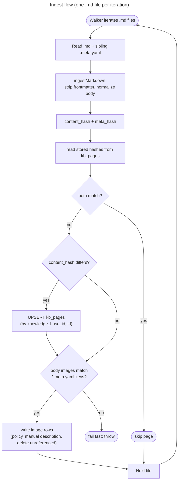

# Ingest (files to pages)

**Does**

- Walk the checkout (see the [corpus layout contract](./01-corpus.md)); parse each `.md` (frontmatter into `title` / `tags`, body normalized); read the sibling `*.meta.yaml` (required when the body references images).
- Compute `content_hash` + `meta_hash`, gate, and upsert `kb_pages`.
- Validate the body's image references against the sibling `*.meta.yaml` (fail-fast on any discrepancy), then record each image's policy in `kb_image_descriptions`; delete rows for images the page no longer references.
- Delete `kb_pages` rows whose file disappeared.

**Reads** — the checkout files and their `*.meta.yaml`; the stored `kb_pages.content_hash` / `meta_hash`; the stored `kb_image_descriptions` rows for the page.

**Owns** — `kb_pages` (`title`, `tags`, `body`, `content_hash`, `meta_hash`, `updated_at`); `kb_image_descriptions.policy`, `.description` (manual), `.description_hash` (manual).

**Staleness** — skip the page when `content_hash` and `meta_hash` both match.

**Never touches** — the chunk tree (`chunkify`); the caption pass's fields (`image_content_hash`, `caption_model`, `hardcoded_caption_prompt_hash`, `captioned_description_hash`); the caption pass's embedding fields (`embedding`, `embedding_model`, `embedded_at`, `embed_input_hash`). Calls no model and reads no image bytes.

## Files

Ingest walks the checkout and gets the included `*.md` files, one per page. The walk rules are the [corpus layout contract](./01-corpus.md).

After processing the files, ingest deletes any `kb_pages` row **of that knowledge base** whose `id` is not among the files the walker returned (the file was deleted upstream):

```text
DELETE FROM kb_pages WHERE knowledge_base_id = <kb>
  AND NOT (id = ANY(<walker ids>));
```

Ingest processes one **read-only** knowledge base per run (`kb_knowledge_bases.writable = false`); writable knowledge bases are updated directly, never ingested.

## Flow

One `.md` file per iteration. The freshness keys are **per page** (`content_hash` + `meta_hash`); there is no per-section hash. Ingest calls no provider and does not chunk or embed.



## Image rows

Ingest validates each page against its sibling `*.meta.yaml` and records the policy for every image the body references in `kb_image_descriptions`:

- **Validation:** the body's image references and the `*.meta.yaml` keys are the **same set** of canonical `image_path`s. A missing entry (a body image not listed) or an extra entry (listed but not referenced) is a discrepancy: ingest **fails fast and throws** — it neither defaults nor repairs.
- **Identity:** `(knowledge_base_id, page_id, image_path)`.
- **Policy:** from the sibling `*.meta.yaml` — `ignore`, `manual`, or `vision-captioning`.
- **`manual` description:** taken from the `*.meta.yaml` when the policy is `manual`.

Rows for images the page no longer references are deleted. A `manual` row's `description` and `description_hash` come from the `*.meta.yaml`; `ignore` clears both. The caption fields (`image_content_hash`, `caption_model`, `hardcoded_caption_prompt_hash`) and `captioned_description_hash` belong to the caption pass; when a row returns to `vision-captioning`, the caption pass re-captions on its own because `description_hash` no longer equals `captioned_description_hash` ([03.2-image-descriptions.md](./03.2-image-descriptions.md#caption-pass)). `embedding` is written by the caption pass (via the shared embed utility) when `description_hash` differs from `embed_input_hash` ([03.2-image-descriptions.md](./03.2-image-descriptions.md#description-embedding)). This step is **policy only** — it never calls a model and never reads image bytes. The `*.meta.yaml` format and rules are [03.2-image-descriptions.md](./03.2-image-descriptions.md).

## Frontmatter

Strip only if the file **begins** with `---\n` … closing `---\n` (optional newline after the closer). A later `---` in the body is a thematic break or content. Unclosed opening `---` is not frontmatter.

Recognized keys: `title`, `tags` (inline `[a, b]` or a YAML list). Trim string values at ingest.

## Body

Canonical `kb_pages.body`:

- `\r\n` / `\r` become `\n` (do this before detecting `---\n` so CRLF files still match)
- strip trailing spaces on each line
- ensure a single final `\n`

The same map is **idempotent**; `chunkify` may re-apply it.

Hashes and parent/child slices use this string — not original file bytes.

## Incremental updates

Two hashes decide whether ingest reprocesses a page:

| Hash           | Covers                                              |
| -------------- | --------------------------------------------------- |
| `content_hash` | `title` + `tags` + `body`                           |
| `meta_hash`    | sha256 of the sibling `*.meta.yaml` bytes (or null) |

Skip the page only when **both** match the stored values. The content encoding is stable:

```ts
sha256(JSON.stringify({ title, tags: [...tags].sort(), body }));
```

| Situation                | Action                                                                                                                                                                                                                                                  |
| ------------------------ | ------------------------------------------------------------------------------------------------------------------------------------------------------------------------------------------------------------------------------------------------------- |
| Both match               | Skip the page                                                                                                                                                                                                                                           |
| Either differs           | Validate the body's images against `*.meta.yaml` (fail fast if they are not the same set), write each image's `policy` and `manual` description, delete rows for images the body no longer references                                                   |
| `content_hash` differs   | Upsert `kb_pages` by `(knowledge_base_id, id)`; the chunk tree's `source_page_hash` no longer equals `content_hash`, so the tree is stale; chunkify's gate compares those two and decides whether to rebuild ([chunk staleness](./README.md#staleness)) |
| `meta_hash` differs only | Body and chunk tree stay; only the page's image rows change                                                                                                                                                                                             |

Image bytes are not part of this gate: a changed image does not touch `kb_pages` or the image policy. The caption pass detects it by comparing the current bytes to the row's `image_content_hash` ([03.2-image-descriptions.md](./03.2-image-descriptions.md#caption-pass)).
