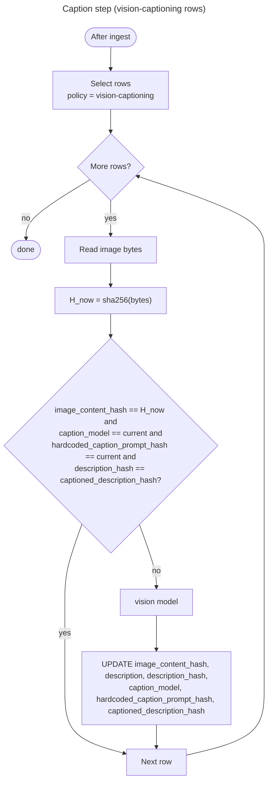
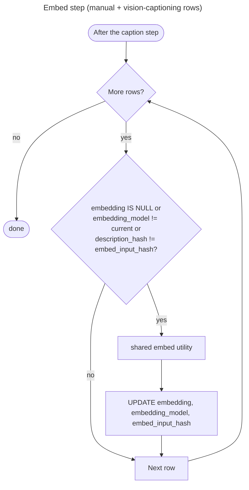

# Image descriptions (`*.meta.yaml` to captions to vectors)

Images referenced by a page are described **outside** `kb_pages.body`. The body keeps the image reference (``) and no caption text is injected into it (ingest's normal [body processing](./02-ingest.md#body) still applies). A sibling `*.meta.yaml` must list every image the body references and says what to do with each; captions live in `kb_image_descriptions`. This is what keeps ingest idempotent when a caption model changes.

Ingest records the policy during reconciliation ([02-ingest.md](./02-ingest.md#image-policy-reconciliation)). This doc is the **image contract**: `*.meta.yaml` format, the caption pass, and description vectors.

## `*.meta.yaml` format

For every ingested `<page>.md`, the walker looks for a sibling `<page>.meta.yaml` in the same directory ([01-corpus.md](./01-corpus.md#include-and-exclude)). It is **required whenever the body references images**, and must list **every** one of them. It is **not** a page and has no `id`.

```yaml
# <page>.meta.yaml
assets/en-US/chapter-1/image-001.png:
  policy: vision-captioning
assets/en-US/chapter-1/image-002.png:
  policy: manual
  description: "The relay sits between the two quays."
assets/en-US/chapter-1/logo.png:
  policy: ignore
```

| Key                  | Value                                                                                       |
| -------------------- | ------------------------------------------------------------------------------------------- |
| canonical image path | see [Canonical image path](#canonical-image-path); **quote it** (`"…"`)                     |
| `policy`             | `ignore` \| `manual` \| `vision-captioning` (required)                                      |
| `description`        | required when `policy: manual`; the stored caption (a YAML block scalar for multiple lines) |
| unknown keys         | rejected                                                                                    |

Rules:

- **Every image the body references must have an entry** (keyed by its canonical `image_path`); a missing entry is an ingest error — there is no default policy.
- **Every entry must match an image the body references.** An entry the body doesn't reference is an ingest error.
- `policy: manual` without a `description` is an error for that page.
- The `*.meta.yaml` file is read as UTF-8 and is part of the page's `meta_hash` ([02-ingest.md](./02-ingest.md#incremental-updates)).

`vision-captioning` is the `*.meta.yaml` policy name; it selects the configured caption model.

## Canonical image path

`image_path` is the image reference resolved to a **repo-root-relative POSIX path**, and it is the same string in the `*.meta.yaml` key and in the stored row.

Given the page's path (`<dir>/<page>.md`, i.e. its `id` plus `.md`) and an image reference `ref` written in the body:

```text
image_path = normalize(posix(<dir>) + "/" + ref)   relative to the repo root
```

- `./a.png` and `a.png` in the same directory share one key (`<dir>/a.png`).
- `../assets/a.png` resolves up one directory.
- Absolute paths and URL-scheme references (`https://…`) are **out of contract** for the `*.meta.yaml`; a page that uses them cannot be described (recorded as `ignore`, with an ingest warning).
- The same canonical form is the `*.meta.yaml` key and the stored `image_path`, so the two agree byte-for-byte.

## Identity

One row per `(knowledge_base_id, page_id, image_path)` — the same image referenced by two pages produces two rows (the default caption prompt uses surrounding page context, so captions are page-local). A page delete cascades to its rows.

| Column                          | Meaning                                                                                                                                 |
| ------------------------------- | --------------------------------------------------------------------------------------------------------------------------------------- |
| `page_id`                       | `(knowledge_base_id, page_id)` FK to `kb_pages` (cascade)                                                                               |
| `image_path`                    | canonical image path (see above)                                                                                                        |
| `image_content_hash`            | sha256 of the image bytes the caption was built from; written by the caption pass; `null` before captioning and for `ignore` / `manual` |
| `policy`                        | `ignore` \| `manual` \| `vision-captioning`                                                                                             |
| `description`                   | the caption text; `null` for `ignore` and for `vision-captioning` before the caption pass                                               |
| `description_hash`              | sha256 of `description`; written with the description                                                                                   |
| `caption_model`                 | `{providerId}::{modelId}` that produced a `vision-captioning` description (`null` for `manual`)                                         |
| `hardcoded_caption_prompt_hash` | sha256 of the hardcoded caption prompt (`null` for `manual`)                                                                            |
| `captioned_description_hash`    | the `description_hash` the caption pass wrote (`null` for `manual`)                                                                     |
| `embedding`                     | pgvector of `description`; `null` until embedded                                                                                        |
| `embedding_model`               | `{providerId}::{modelId}` that produced `embedding`                                                                                     |
| `embedded_at`                   | when `embedding` was last written                                                                                                       |
| `embed_input_hash`              | sha256 of the `description` that `embedding` was computed from; `null` until embedded                                                   |

`image_content_hash` is recorded for `vision-captioning` rows only, and only once captioned; `manual` / `ignore` rows leave it `null`. It is the hash of the image the current caption was built from; the caption pass sets it when it writes a caption. It is not part of the ingest gate ([02-ingest.md](./02-ingest.md#incremental-updates)).

## Caption pass

Runs after ingest. It is the **only** place that calls the vision model, and it also embeds the descriptions via the shared embed utility. One run has two steps: a **caption step** over `vision-captioning` rows, then an **embed step** over every `manual` / `vision-captioning` description ([Description embedding](#description-embedding)).



- **Freshness is an input comparison.** The pass reads the image, computes `H_now`, and compares it to the row's `image_content_hash`, the hash the stored caption was built from. It also compares the stored `caption_model` and `hardcoded_caption_prompt_hash` to the current ones, and the stored `description_hash` to its own `captioned_description_hash`.
- **Skip the caption step** when all hold: `image_content_hash` = `H_now`, `caption_model` = current model, `hardcoded_caption_prompt_hash` = current prompt hash, `description_hash` = `captioned_description_hash`, and a `description` exists. Skipping the caption does not skip embedding — the embed step still (re)embeds the row when its vector is stale ([Description embedding](#description-embedding)).
- **Re-caption** otherwise: call the vision model, normalize the reply to a single line, and write `image_content_hash = H_now`, `description`, `description_hash`, the two caption fields, and `captioned_description_hash = description_hash`. The pass then re-embeds the description because `description_hash` changed ([Description embedding](#description-embedding)).
- **`ignore` / `manual` rows are never re-captioned here.** `manual` descriptions are written by ingest from the `*.meta.yaml` and are embedded (not captioned); when a row returns to `vision-captioning`, the caption pass re-captions because the stored `description_hash` no longer equals `captioned_description_hash`.
- **Failure policy.** A failed vision call leaves the previous `description` (or `null`) and logs; the next caption pass retries because the freshness key still differs. Pass `failFast` only for admin diagnostics.
- `hardcoded_caption_prompt_hash` is `sha256` of the hardcoded caption prompt. Editing the prompt changes the hash, so captions regenerate.

## Description embedding

The caption pass embeds each description through the shared embed utility using the **embedding** model. A row is (re)embedded when:

```sql
policy IN ('manual', 'vision-captioning')
AND description IS NOT NULL
AND (embedding IS NULL
     OR embedding_model IS DISTINCT FROM $current_model
     OR description_hash IS DISTINCT FROM embed_input_hash)
```



The caption pass stamps `embed_input_hash` with the `description_hash` it embedded. `manual` descriptions are embedded too, so they are searchable. A changed description (or a changed model) is detected here by comparing the row's own hashes; no other stage clears `embedding`.
