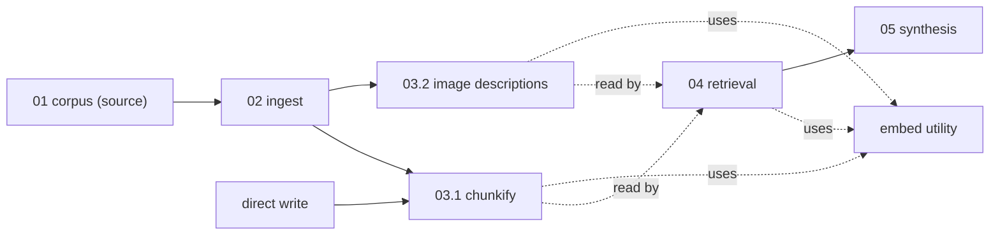

# Knowledge-base design

- Write path
  - read-only knowledge bases flow from `corpus` through `ingest` to `chunkify` / image descriptions
  - writable ones flow from direct write to `chunkify`.

- Read path: retrieval, then synthesis over the HTTP contract in
  [Appendix B](./appendix-b-protocol.md).

Vectors are produced and consumed through a shared embed utility, not a flow step. Embedding is not a stage: a stage that produces embeddable content calls the utility as part of its own write.

The stages are independent: each can run on its own, and its staleness gate decides whether it does any work. This app triggers every stage manually; wiring them together (an application-level job, a "sync") is optional and would live at the application layer.

The read path is the stateless neuxus core. Clients own their own sessions, memory, and end users; `apps/api-chat` is one such client. The client is the agent; neuxus supplies evidence, not intent or tool decisions. The HTTP contract is [Appendix B](./appendix-b-protocol.md).

Content lives in **knowledge bases**: each is either **read-only** (pages ingested from a corpus and written only by the ingest stage) or **writable** (pages updated directly, not by ingest). `writable` is fixed at creation. Every write and search targets one knowledge base, specified by the request. A search query names one knowledge base; clients discover ids via [`GET /knowledge-bases`](./appendix-b-protocol.md#get-knowledge-bases).

| Doc                                                        | Contract                                                                                                                                                                                 |
| ---------------------------------------------------------- | ---------------------------------------------------------------------------------------------------------------------------------------------------------------------------------------- |
| [01-corpus.md](./01-corpus.md)                             | Corpus source: what content is in scope for ingest                                                                                                                                       |
| [02-ingest.md](./02-ingest.md)                             | Walk the checkout; markdown file becomes a `kb_pages` row (frontmatter, staleness gate); validate images against `*.meta.yaml` and record each image's policy in `kb_image_descriptions` |
| [03.1-chunkify.md](./03.1-chunkify.md)                     | Derive parents / children from `kb_pages.body`                                                                                                                                           |
| [03.2-image-descriptions.md](./03.2-image-descriptions.md) | Image captions + description vectors (policy from `*.meta.yaml`)                                                                                                                         |
| [04-retrieval.md](./04-retrieval.md)                       | Query in, ranked parents out (+ ranked image descriptions)                                                                                                                               |
| [05-synthesis.md](./05-synthesis.md)                       | Deterministic, capability-neutral context enrichment with explicit layout/order and request/response validation: Anthropic request in, enriched answer + `neuxus` out                    |
| [appendix-a-data-model.md](./appendix-a-data-model.md)     | Tables                                                                                                                                                                                   |
| [appendix-b-protocol.md](./appendix-b-protocol.md)         | HTTP protocol: Anthropic-compatible request, neuxus-extended response                                                                                                                    |

## Staleness

**Comparison first, then the write.**

| Redo what                                                                                                                                                                                             | Condition                                                                                                                                                                                                                                                                                                                                                                                       |
| ----------------------------------------------------------------------------------------------------------------------------------------------------------------------------------------------------- | ----------------------------------------------------------------------------------------------------------------------------------------------------------------------------------------------------------------------------------------------------------------------------------------------------------------------------------------------------------------------------------------------- |
| rewrite the `kb_pages` row (`title`, `tags`, `body`)                                                                                                                                                  | **Ingest** — the recomputed `content_hash` (from `title` + `tags` + `body`) differs from the stored `content_hash`                                                                                                                                                                                                                                                                              |
| validate the body's images against `*.meta.yaml` (fail fast if they are not the same set), write each image's `policy` and `manual` description, delete rows for images the body no longer references | **Ingest** — the recomputed `content_hash` or `meta_hash` differs from the stored value                                                                                                                                                                                                                                                                                                         |
| rebuild the parent/child tree and embed its children                                                                                                                                                  | **Chunkify** — the tree's `source_page_hash` (the `content_hash` used to build the tree) differs from the current `content_hash`                                                                                                                                                                                                                                                                |
| re-embed the children                                                                                                                                                                                 | **Chunkify** — a child's `embedding_model` (the model used to embed it) differs from the current model                                                                                                                                                                                                                                                                                          |
| re-caption (only `vision-captioning` rows)                                                                                                                                                            | **Caption pass** — any of: • any of the caption's `image_content_hash` / `caption_model` / `hardcoded_caption_prompt_hash` (the captioned image bytes / model / prompt) differs from the current image / model / prompt • `description_hash` (the description's hash) differs from `captioned_description_hash` (the `description_hash` the caption wrote) • there is no `description` |
| re-embed the image descriptions (both `manual` and `vision-captioning` rows)                                                                                                                          | **Caption pass** — any of: • `embedding_model` (the model used to embed the description) differs from the current model • `embed_input_hash` (the `description_hash` that was embedded) differs from `description_hash`                                                                                                                                                                   |

A changed embedding model does not trigger a run by itself; the owning stage re-embeds on its next run.

Model choice is application wiring: [`GET /v1/models`](./appendix-b-protocol.md#get-v1models) lists requestable models for synthesis, while embedding and captioning tasks are linked in [`app_model_task_config`](./appendix-a-data-model.md#model-config-tables). Provider connections live in `app_model_provider_config`; no `kb_*` settings table holds a model id.
