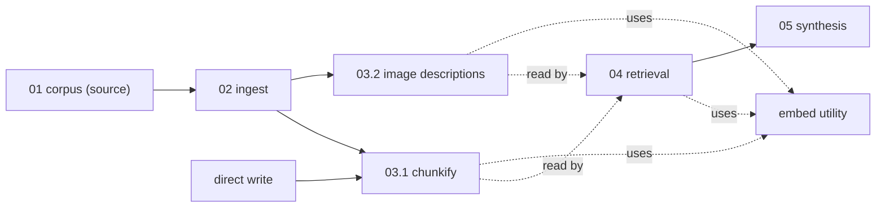

# Knowledge-base design

- Write path
  - read-only knowledge bases flow from `corpus` through `ingest` to `chunkify` / image descriptions
  - writable ones flow from direct write to `chunkify`.

- Read path: retrieval, then synthesis.

Vectors are produced and consumed through a shared embed utility, not a flow step.

The stages are independent: each can run on its own, and its freshness key decides whether it does any work. Wiring them together (an application-level job, a "sync") is optional and application layer.

Content lives in **knowledge bases**: each is either **read-only** (pages ingested from a corpus and written only by the ingest stage) or **writable** (pages updated directly, not by ingest). Every write targets one knowledge base; a search query targets a set of one or more, specified by the request. The backend persists no grouping.

| Doc                                                        | Contract                                                                                                                                          |
| ---------------------------------------------------------- | ------------------------------------------------------------------------------------------------------------------------------------------------- |
| [01-corpus.md](./01-corpus.md)                             | Corpus layer: what content is in scope for ingest                                                                                                 |
| [02-ingest.md](./02-ingest.md)                             | Discover files; markdown file becomes a `kb_pages` row (frontmatter, hash skip); record each referenced image's policy in `kb_image_descriptions` |
| [03.1-chunkify.md](./03.1-chunkify.md)                     | Derive parents / children from `kb_pages.body`                                                                                                    |
| [03.2-image-descriptions.md](./03.2-image-descriptions.md) | Image captions + description vectors (policy from `*.meta.yaml`)                                                                                  |
| [04-retrieval.md](./04-retrieval.md)                       | Question in, ranked parents out (+ ranked image descriptions)                                                                                     |
| [05-synthesis.md](./05-synthesis.md)                       | Prompt in, answer out (image descriptions folded into the prompt)                                                                                 |
| [appendix-a-data-model.md](./appendix-a-data-model.md)     | Tables                                                                                                                                            |

## Freshness keys

Each stage derives a key from its inputs and compares it to the stored value; only a mismatch does work — **comparison first, then the write**.

| Key                                                                                     | Written                                                                                          | Compared                                                                                                                                  | On mismatch                                                                                                                         |
| --------------------------------------------------------------------------------------- | ------------------------------------------------------------------------------------------------ | ----------------------------------------------------------------------------------------------------------------------------------------- | ----------------------------------------------------------------------------------------------------------------------------------- |
| `content_hash`                                                                          | Ingest computes from `title` + `tags` + `body`                                                   | Ingest compares the recomputed hash with the stored `content_hash`                                                                        | re-ingest the page                                                                                                                  |
| `meta_hash`                                                                             | Ingest computes from the sibling `*.meta.yaml` bytes                                             | Ingest compares the recomputed hash with the stored `meta_hash`                                                                           | record each referenced image's policy (and `manual` description) in `kb_image_descriptions`; delete rows for unreferenced images     |
| `source_page_hash`                                                                      | Chunkify copies `content_hash` into the tree when it (re)builds — after the comparison shows it stale | Chunkify compares the tree's `source_page_hash` with the current `content_hash`                                                           | rebuild the parent/child tree                                                                                                       |
| `image_content_hash`, `caption_model`, `hardcoded_caption_prompt_hash`                  | Caption pass computes the image-bytes hash and the prompt hash, and records the model           | Caption pass compares the recomputed image hash with `image_content_hash`, and the current model and prompt with `caption_model` and `hardcoded_caption_prompt_hash` | re-caption (also if no `description`)                                                                                               |
| `embedding_model`                                                                       | Embed records the model that produced the vector                                                 | Embed compares the stored `embedding_model` with the current model                                                                        | re-embed                                                                                                                            |
| `description_hash`                                                                      | Caption pass (vision) or Ingest (manual) computes from the description text                      | Embed compares `description_hash` with `embedded_description_hash`                                                                        | re-embed the image-description vector                                                                                               |
| `embedded_description_hash`                                                             | Embed copies `description_hash` when it writes the vector                                        | Embed compares `description_hash` with `embedded_description_hash`                                                                        | re-embed the image-description vector                                                                                               |

The embedding, captioning, and synthesis models are application wiring: [`app_model_task_config`](./appendix-a-data-model.md#model-config-tables) task links, with provider connections in `app_model_provider_config`. No `kb_*` settings table holds a model id.
