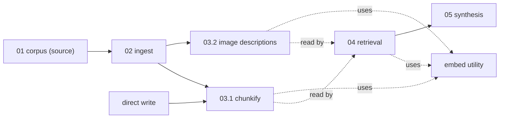

# Knowledge-base design

- Write path
  - read-only knowledge bases flow from `corpus` through `ingest` to `chunkify` / image descriptions
  - writable ones flow from direct write to `chunkify`.

- Read path: retrieval, then synthesis.

Vectors are produced and consumed through a shared embed utility, not a flow step. Embedding is not a stage: a stage that produces embeddable content calls the utility as part of its own write.

The stages are independent: each can run on its own, and its freshness key decides whether it does any work. Wiring them together (an application-level job, a "sync") is optional and application layer.

Content lives in **knowledge bases**: each is either **read-only** (pages ingested from a corpus and written only by the ingest stage) or **writable** (pages updated directly, not by ingest). Every write targets one knowledge base; a search query targets a set of one or more, specified by the request. The backend persists no grouping.

| Doc                                                        | Contract                                                                                                                                                                                |
| ---------------------------------------------------------- | --------------------------------------------------------------------------------------------------------------------------------------------------------------------------------------- |
| [01-corpus.md](./01-corpus.md)                             | Corpus layer: what content is in scope for ingest                                                                                                                                       |
| [02-ingest.md](./02-ingest.md)                             | Walk the checkout; markdown file becomes a `kb_pages` row (frontmatter, freshness key); validate images against `*.meta.yaml` and record each image's policy in `kb_image_descriptions` |
| [03.1-chunkify.md](./03.1-chunkify.md)                     | Derive parents / children from `kb_pages.body`                                                                                                                                          |
| [03.2-image-descriptions.md](./03.2-image-descriptions.md) | Image captions + description vectors (policy from `*.meta.yaml`)                                                                                                                        |
| [04-retrieval.md](./04-retrieval.md)                       | Question in, ranked parents out (+ ranked image descriptions)                                                                                                                           |
| [05-synthesis.md](./05-synthesis.md)                       | Prompt in, answer out (image descriptions folded into the prompt)                                                                                                                       |
| [appendix-a-data-model.md](./appendix-a-data-model.md)     | Tables                                                                                                                                                                                  |

## Freshness keys

Each row is a key a stage keeps. When that stage runs, it compares the key with the current value and does work only where they differ (a missing `description` counts as a difference) — **comparison first, then the write**. Embedding is a utility, not a stage: the stage that owns a vector — **Chunkify** for children, the **Caption pass** for image descriptions — keeps the model it embedded with, so when it runs it re-embeds any of its vectors whose model no longer matches. A changed embedding model on its own triggers nothing; the owning stage catches it the next time it runs.

| Key                                                                                                    | Written                                                                                                                                              | Compared                                                                                                                                                                 | On mismatch                                                                                                           |
| ------------------------------------------------------------------------------------------------------ | ---------------------------------------------------------------------------------------------------------------------------------------------------- | ------------------------------------------------------------------------------------------------------------------------------------------------------------------------ | --------------------------------------------------------------------------------------------------------------------- |
| `content_hash`                                                                                         | **Ingest** computes from `title` + `tags` + `body`                                                                                                   | **Ingest** compares the recomputed hash with the stored `content_hash`                                                                                                   | re-ingest the page                                                                                                    |
| `meta_hash`                                                                                            | **Ingest** computes from the sibling `*.meta.yaml` bytes                                                                                             | **Ingest** compares the recomputed hash with the stored `meta_hash`                                                                                                      | record each image's policy (and `manual` description) in `kb_image_descriptions`; delete rows for unreferenced images |
| `source_page_hash`                                                                                     | **Chunkify** copies `content_hash` into the tree when it (re)builds — after the comparison shows it stale                                            | **Chunkify** compares the tree's `source_page_hash` with the current `content_hash`                                                                                      | rebuild the parent/child tree                                                                                         |
| `embedding_model` (children)                                                                           | **Chunkify** records the model when it embeds the children via the shared embed utility                                                              | **Chunkify** compares the stored model with the current one                                                                                                              | re-embed the children                                                                                                 |
| `image_content_hash`, `caption_model`, `hardcoded_caption_prompt_hash` (only `vision-captioning` rows) | **Caption pass** computes the image-bytes hash and the prompt hash, and records the model                                                            | **Caption pass** compares the recomputed image hash with `image_content_hash`, and the current model and prompt with `caption_model` and `hardcoded_caption_prompt_hash` | re-caption on any mismatch, or if no `description`                                                                    |
| `captioned_description_hash` (only `vision-captioning` rows)                                           | **Caption pass** copies `description_hash` when it writes the caption                                                                                | **Caption pass** compares `description_hash` with `captioned_description_hash`                                                                                           | re-caption                                                                                                            |
| `embedding_model`, `embed_input_hash` (image descriptions)                                             | **Caption pass** records the model and copies `description_hash` into `embed_input_hash` when it embeds the description via the shared embed utility | **Caption pass** compares the stored model with the current one, and `embed_input_hash` with `description_hash`                                                          | re-embed the image descriptions                                                                                       |
| `description_hash` (image vectors)                                                                     | **Caption pass** (vision) or **Ingest** (manual) computes from the description text                                                                  | **Caption pass** compares it with `captioned_description_hash` (caption) and with `embed_input_hash` (embed)                                                             | re-caption or re-embed                                                                                                |

The embedding, captioning, and synthesis models are application wiring: [`app_model_task_config`](./appendix-a-data-model.md#model-config-tables) task links, with provider connections in `app_model_provider_config`. No `kb_*` settings table holds a model id.

Independently of the gate, ingest also **validates** on every reprocessed page that the body's image references and the `*.meta.yaml` keys are the same set; a discrepancy fails fast ([02-ingest.md](./02-ingest.md#image-policy-reconciliation)).
